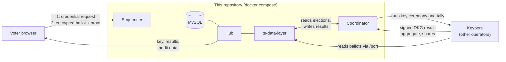

# Permanent private voting (`shutter-elgamal`)

> **Alpha.** The space's privacy settings show an "Alpha" tag on **Permanent private voting**.

Permanent private voting is a proposal privacy mode, `privacy: 'shutter-elgamal'`, in which every
ballot is encrypted in the browser and **stays encrypted forever**. Only the final tally is
revealed. The Snapshot backend cannot decrypt an individual vote at any point: not during voting,
not after, and not with its database.

It is built on **linearly homomorphic threshold ElGamal over BLS12-381**. Voters encrypt under a
committee master public key, the ciphertexts are summed homomorphically, and a committee of
independent **keypers** jointly decrypts only the sum.

**Snapshot does not run the keypers.** They are a service of the [Shutter Governance
Protocol][sgp] (SGP). Each is run by a separate operator holding a signing key this repository never
sees. The **coordinator** runs in this repository's `docker-compose.yml`, from a published image: it
runs the key ceremony and the tally with the keypers, relays their signed writes, and publishes the
result. It holds no key share and cannot decrypt.

To run it, follow **[`DEPLOYMENT_SETUP.md`](./DEPLOYMENT_SETUP.md)**: environment, stack, a
proposal, a vote and the published tally, plus troubleshooting.

[sgp]: https://github.com/shutter-network/shutter-governance-protocol

---

## Contents

- [How it works](#how-it-works)
- [Where the code lives](#where-the-code-lives)
- [Crypto parameters](#crypto-parameters)
- [Weight scaling](#weight-scaling--the-units-a-proposal-counts-in)
- [Coordinator sizing](#coordinator-sizing--what-a-tally-costs)
- [Lifecycle of a proposal](#lifecycle-of-a-proposal)
- [Security model](#security-model)
- [Operational rules](#operational-rules)

---

## How it works



1. **Key generation.** When a private proposal is created, the sequencer freezes the committee onto
   it. The coordinator then runs a Feldman-VSS distributed key generation with the keypers, and the
   keypers publish one master public key (`te_mpk`). No party ever holds the full secret. If voting
   opens before the key exists, nobody can vote and the proposal is permanently marked as a failed
   key generation.
2. **Voting.** The browser asks the sequencer for an eligibility credential, which binds the voter's
   voting power to a one-time key. It then encrypts the vote under `te_mpk`, attaches a
   zero-knowledge proof that the ballot is well formed (a range per candidate plus an exact budget),
   and signs it with the one-time key and with the voter's wallet (EIP-712). The sequencer verifies
   every ballot when it receives it.
3. **Aggregation.** After voting closes, **every keyper independently computes** the weighted sum on its own, from
   the same ordered ballots, and sends it signed to the coordinator. The sum counts only when a
   quorum of keypers submits **byte for byte identical**. So isolating one voter's ballot needs a
   majority of the committee, not one compromised process.
4. **Decryption.** Each keyper publishes a partial decryption with a DLEQ proof. The coordinator
   recovers the totals by Lagrange interpolation and baby-step giant-step, signs them and publishes
   them. The hub checks the signature, and the sequencer copies the totals into the proposal's
   scores.

A voter with voting power `vp` is counted `w = round(vp)` times: their ciphertexts are multiplied by
`w` before the sum, with no change to the ballot cryptography.

---

## Where the code lives

| Component | Path | Role |
| --- | --- | --- |
| Client crypto SDK | `@shutter-network/urban-verified-crypto` | Ballot construction, ZK proofs, verification, tally recovery. Published package, BLST WASM. |
| Hub | [apps/hub](../../apps/hub) | GraphQL/REST. Stores ballots, DKG results, aggregates, shares and results. Checks the signature on every protocol write. |
| Sequencer | [apps/sequencer](../../apps/sequencer) | Issues credentials, receives and verifies ballots, freezes the committee onto each proposal, copies published totals into `scores`. |
| Translator | [apps/te-data-layer](../../apps/te-data-layer) | Presents the hub to the protocol as its data layer. |
| Voter UI | [apps/ui](../../apps/ui) | Builds encrypted ballots in the browser; the "Verify tally" panel; the stall notice and admin retry. |
| Coordinator | published SGP image, run by `docker-compose.yml` | Runs the key ceremony and the tally with the keypers, relays their writes, publishes the result. |
| Keypers | **not in this repository** | Run by independent operators from the protocol repository. |

---

## Crypto parameters

| Parameter | Value |
| --- | --- |
| Curve | BLS12-381 (ElGamal in G₂, Schnorr in G₁) |
| Threshold | Set per deployment: `t` is `TE_THRESHOLD_T` and `n` is the number of `TE_KEYPERS`; the local setup uses `t = 2, n = 3`. `t` is the **quorum**: the number of keypers that must act together |
| Ballot variant | Variant A, exact budget `B = 1` (single choice, basic) or `B = TE_WEIGHTED_BUDGET`, default 100 (weighted) |
| DKG | Feldman verifiable secret sharing |
| Write authorisation | Keypers sign the `SHUTTER-GOVERNANCE-PROTOCOL-DKG-RESULT-v1`, `-AGGREGATE-v1` and `-DECRYPT-SHARE-v1` digests directly. The result publisher signs the `-RESULT-v1` digest wrapped in `SHUTTER-GOVERNANCE-PROTOCOL-REQUEST-v1` (op `result`). Stall and resume requests sign `-REQUEST-v1` with op `tally_stall` or `tally_resume` |

### Weight scaling — the units a proposal counts in

The coordinator recovers a tally by searching a range of size `budget x Σ(weights)`, so a large
enough electorate would make the search too big to solve. Instead of capping anyone, a private
proposal uses a **scale**: every voter's weight is divided by the same power of two, and the tally is
counted in those units.

```
scale  = smallest power of two s such that  budget x ceil(V / s) <= TE_SOLVER_CEILING
weight = (round(vp) + s/2) // s       integer half-up, the same in the UI and the committee
```

`V` is an upper bound on the proposal's total voting power. It is resolved **once, at creation**,
and frozen into `te_sgp_config` together with `TE_SOLVER_CEILING`. `scale` is then derived from
those two values and the proposal's current budget, because the voting type can still change before
voting opens.

| Space's strategies | `V` |
| --- | --- |
| All recognised token strategies (`erc20-balance-of`, `erc20-votes`, `erc20-balance-of-delegation`, `erc721`, `erc721-enumerable`) | Sum of `totalSupply()` at the proposal's snapshot block |
| None of them (`ticket`, `whitelist`, quadratic, custom …) | The fallback: `floor(TE_SOLVER_CEILING / weighted budget)` |
| A mix of both | The larger of the recognised supply and the fallback |

The fallback is the largest `V` that keeps `scale = 1` on a weighted proposal, so a space whose
voting power cannot be measured keeps full precision. It always uses the weighted budget because
the voting type can be changed to weighted after `V` is frozen. There is no override;
`TE_SOLVER_CEILING` is the only setting that moves it.

**`scale` is 1 for almost every real space**, and then none of this is visible. At the default
ceiling of 1e12 and a budget of 100, scaling starts above 1e10 whole tokens of total supply.
Dividing everyone by the same amount keeps every ratio between voters; each voter loses at most half
a unit.

**What a voter sees when `scale > 1`.** The proposal sidebar says *"Counted as N. This proposal
counts in units of S, so every voter's power is divided by the same amount."* A vote can count for
zero in two different ways:

- **Raw voting power below 0.5:** the sequencer refuses the credential, so the voter cannot vote.
  A ballot would count for nothing, and a refusal tells the voter so.
- **Weight of at least 1 but below `scale/2`:** the vote is *admitted*. The ballot is recorded and
  summed with weight zero. The UI warns before signing (*"Your vote would not move this tally"*).
  Raising `TE_SOLVER_CEILING` fixes it for later proposals.

**Worked example.** A token with 1,011,123 supply, budget 100, holders of 995,500 / 69 / 53 / 31:

| `TE_SOLVER_CEILING` | `scale` | Counted |
| --- | --- | --- |
| 1e12 (default) | 1 | 995,500 / 69 / 53 / 31, all in full |
| 1e6 | 128 | 7,777 / 1 / 0 / 0, the last two admitted but worth nothing |

**If `V` turns out too low**, the sequencer logs an alarm that names `TE_SOLVER_CEILING` once
`budget x ceil(total weight / scale)` passes it, where the total is the weight of the votes so far
plus the credential being issued. It does not refuse votes: the tally gets
slower, but stays possible.

---

### Coordinator sizing — what a tally costs

Recovering the per-candidate totals means **searching for a discrete logarithm** over the range
`budget x Σ(admitted weights)`, using baby-step giant-step. This search is the coordinator's job at
tally time, and it is the only cost that depends on how much voting power took part.

**Cost model.** With `m = √(budget x Σw)`:

```
tally time    ≈ 2m x 11 µs      (m operations to build the table, plus about m giant steps in total)
table memory  ≈ 218 B x m
```

Both constants were measured against `py_arkworks_bls12381`, the coordinator's curve library:

- **11 µs per operation** (G₂ add + compress + hash-map operation), stable from `m = 3e5` to
  `m = 5e6`. The model is within 5% of measured runs: bound 1e12 gives 22 s predicted, 22.9 s
  measured; 9e12 gives 66 s and 69.4 s; 2.5e13 gives 110 s and 107.9 s.
- **218 bytes per table entry**, linear at 500k and 2M entries: 144 B for the 96-byte compressed
  point, 32 B for the integer value, 42 B of hash-map slot.

The table is built once and reused for every candidate, and the giant steps of all candidates add up
to about `m`. So **the number of candidates does not change the tally cost.**

**Machine table.** Sized at about 300 B of machine RAM per entry: the 218 B table plus the hash-map
resize, the interpreter, the ballots and the aggregate. Measure on Linux: macOS compresses memory, so
`ps` there shows about half the real footprint.

| Coordinator RAM | `m` | Search bound `budget x Σw` = **`TE_SOLVER_CEILING`** | Max Σ voting power at `scale = 1`, budget 1 | Max Σ voting power at `scale = 1`, budget 100 | Tally time |
| --- | --- | --- | --- | --- | --- |
| 1 GB | 3.6e6 | 1.3e13 | 1.3e13 | 1.3e11 | 1.3 min |
| **2 GB** | 7.2e6 | **5.1e13** | **5.1e13** | **5.1e11** | **2.6 min** |
| 4 GB | 1.4e7 | 2.0e14 | 2.0e14 | 2.0e12 | 5.3 min |
| 8 GB | 2.9e7 | 8.2e14 | 8.2e14 | 8.2e12 | 11 min |
| 16 GB | 5.7e7 | 3.3e15 | 3.3e15 | 3.3e13 | 21 min |
| 32 GB | 1.1e8 | 1.3e16 | 1.3e16 | 1.3e14 | 42 min |
| 64 GB | 2.3e8 | 5.2e16 | 5.2e16 | 5.2e14 | 84 min |

**How to use it.** Pick the row for the RAM you give the coordinator and set `TE_SOLVER_CEILING` to
that row's **search bound**. Every proposal derives its `scale` from this value: too low scales
proposals that did not need it, too high allows a tally the machine cannot finish.

The default, `1e12`, is below the smallest row: a ~218 MB table and a ~22 s tally, which suits a
0.5 GB coordinator. **Raise it to match your coordinator.** "Σ voting power" means the voting power of
the ballots actually cast, not the total supply. The cost grows with the square root, so **4x the RAM
handles 16x the voting power**. The voting-power columns show where scaling starts, not a hard limit.

**2 GB covers almost every DAO.** At budget 100 it allows 5.1e11 of cast voting power: a token with
1e9 total supply stays 500x below that even at 100% turnout. Tokens with a supply of 1e14–1e15 need
32 GB or more on weighted proposals, or 4–16 GB on single-choice ones.

**Tally cost is not what limits a proposal's size.** Every keyper verifies every ballot when it is
admitted, at about 2.7 ms per proof branch and `choices x (budget + 1)` branches per ballot. For a
5-choice weighted proposal that is 1.36 s per ballot, so 1,000 ballots take **about 23 minutes to
admit and 23 seconds to tally**. Ballot count, choices and budget limit an election long before
voting power does.

**The sequencer's check is about 10 times slower.** Before storing a private ballot, the sequencer
checks the same proofs with the JavaScript SDK, at about 26 ms per branch: about 8 s for a 3-choice
weighted ballot at budget 100, and about 50 s for 19 choices. It runs one check per worker
(`TE_VERIFY_WORKERS`, default: CPU cores minus one), and answers "sequencer busy" once every worker
has two checks running or waiting. So it accepts about `60 × workers ÷ seconds per ballot` private
ballots a minute. Size the workers for the busiest minute you expect, usually just before voting
closes.

---

## Lifecycle of a proposal

| Stage | What must be true |
| --- | --- |
| Creation | Opens at least `MIN_DKG_LEAD_TIME_S` (180 s) ahead. The sequencer must be able to reach every keyper's `/status` the first time it resolves the committee (see the operational rules) |
| DKG | Needs **every** member, not just a quorum. Fails permanently if voting opens first |
| Voting | `te_mpk` present; every ballot verified when received and carrying an eligibility credential |
| Aggregation | Voting has ended; a quorum of byte-identical aggregates makes one canonical |
| Decryption | A canonical aggregate exists; every share is DLEQ-verified against it |
| Result | Signed by the coordinator and checked against the frozen `resultPublisherAddress` |
| Scores | The sequencer writes `scores = total x scale / budget` with `scores_state = 'final'` |

Two states are visible to users:

- **Stalled:** the committee could not finish the tally. The flag is stored, so a coordinator restart
  does not resume the tally on its own. A space admin clears it from the proposal page. The
  coordinator sets the flag and an admin clears it, each with their own signature.
- **DKG failed:** voting opened with no key. Permanent. It is computed when read, not stored:
  `privacy ∧ ¬te_mpk ∧ now > start`.

---

## Security model

With `t = 2, n = 3`, two keypers must cooperate to decrypt anything, and one alone learns nothing.
Two acting together can open individual ballots, not only the tally.

| Adversary | Outcome |
| --- | --- |
| Network observer (passive) | Sees freshly randomised ciphertexts and public signatures. The candidate vector is information-theoretically hidden. No exposure beyond Snapshot's existing voter↔proposal links. |
| Single malicious keyper | Holds 1 of 3 shares and learns nothing. A malformed share fails its DLEQ proof, which the "Verify tally" button checks again. |
| Two colluding keypers (= `t`) | **Privacy is lost.** `t` shares recover the election secret, and every ballot is encrypted under the same key, so they can open any ballot (`C2 - x*C1`; the plaintext range is small). The pseudonym does not hide the voter: it is `keccak256(voter ‖ proposalId)`, and the list of voters is public through the hub's GraphQL `votes`. **Privacy holds only while fewer than `t` keypers collude.** That is an assumption about who is on the committee, not a property of the cryptography. See *Operator policy* below. |
| Ballot stuffing | The budget proof requires the ciphertexts to add up to exactly `B`. Over-budget ballots fail verification when received. |
| Replay across proposals | Each ballot binds the proposal id into `electionId` and into `pseudonym = keccak256(voter ‖ proposalId)`. |
| Deleting an inconvenient tally | **Not prevented.** A private proposal can be deleted on the same terms as a public one, at any time, by its author, an admin or a moderator, and its committee data is deleted with it. Unlike a public tally, it cannot be reconstructed afterwards. Accepted deliberately. |
| Long-term key compromise | Each proposal runs a fresh DKG, so a leaked key exposes only that proposal. |

**Trust boundary.** This deployment runs the hub, the translator and the sequencer, and treats them as
**trusted**. A compromise of any of them is not defended against. Two consequences:

- **Tally integrity still holds.** The aggregate counts only when a keyper quorum submits identical
  bytes, every decryption share has a DLEQ proof, and "Verify tally" recomputes the aggregate from the
  raw ballots and checks the published totals. None of this can be forged outside the committee.
- **Ballot authenticity does not.** The sequencer's `POST /te_attestation` issues a credential for
  any named `voter` without authentication. Code running as the hub or the translator could request a
  credential with a victim's weight, sign a ballot with its own one-time key and serve it in the
  committee's ballot feed; every committee-side check would pass. The ballot feed carries no wallet
  (EIP-712) signature, so the committee cannot tie a ballot to an address on its own.

Ordinary voting is **not** affected: every path a user can reach goes through the sequencer, which
derives the pseudonym from the wallet-signed address and rejects any ballot that disagrees
(`helpers/te.ts::verifyTeBallot`, called from `writer/vote.ts`). Closing the gap would need
authenticated credential issuance and a wallet-signed binding passed to the keypers. That was
declined: it adds a second wallet prompt to every private vote, to defend against services this
deployment already trusts. **A deployment that does not control its own hub should not rely on ballot
authenticity.**

The rule that follows: **unsigned data from the hub may tell a person where to look, but must never
trigger an automated action or replace a cryptographic check.** For example, the hub stores an
optional stall reason without a signature (the 0.1.0 coordinator sends none). It may be shown to an
admin; if it ever drove an automatic retry, it would first have to be added to the signed
`tally_stall` digest.

**Out of scope:** denial of service and availability, host side channels, coercion resistance, and
quantum adversaries (BLS12-381 is not post-quantum, like every BLS12-381 system).

**Known limitation: committee discovery.** `TE_KEYPERS` holds URLs. The sequencer reads each
keyper's address from its `/status` and freezes it into the proposal. Over HTTPS the certificate
vouches for that address; over plain HTTP only the network path does. Use HTTPS keyper URLs in any
real deployment.

**Operator policy:** three keypers run by three independent organisations, each with its own signing
key and its own encrypted state directory. A keyper that fails verification during an audit is
removed from the committee before the next proposal.

---

## Operational rules

- **The sequencer resolves the committee once and caches it.** It reads every keyper's `/status` the
  first time it needs the committee after it starts, or after `TE_KEYPERS` changes. Every keyper must
  be reachable at that moment, or proposal creation fails. Because of the cache, a keyper that
  changes its signing key is only picked up after the sequencer restarts.
- **Two keyper URLs must not report the same address.** A committee of "3" that is really 2 keys
  would let one operator meet `t = 2`. The sequencer refuses it.
- **Editing is allowed until `start`**, including inside the DKG lead time once the key exists. An
  edit cannot change `start`. Making a private proposal public keeps its committee and key, unused;
  making it private again reuses them, because the keypers refuse a second key ceremony for the same
  proposal.
- **Private voting closes one second before public voting.** The protocol's window is half-open
  (`start <= t < end`), while Snapshot's includes `end`. A private vote timestamped exactly at `end`
  is refused, because the committee would exclude it and "Verify tally" would then report the whole
  tally as unverified.
- **`t = 2, n = 3` means "2-of-3"**: two keypers must cooperate. Counting tolerated faults instead
  (`t = 1`) gives a config the sequencer refuses: *"TE_THRESHOLD_T (1) is not a majority of n = 3"*.
