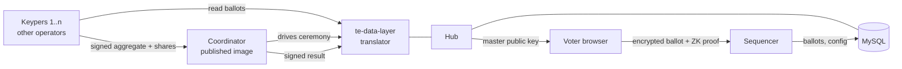

# Permanent private voting (`shutter-elgamal`)

> **Alpha.** The UI shows an "Alpha" tag on the **Permanent private voting** privacy option.

Permanent private voting is a proposal privacy mode, `privacy: 'shutter-elgamal'`, in which every
ballot is encrypted in the browser and **stays encrypted forever**. Only the final tally is
revealed. The Snapshot backend cannot decrypt an individual vote at any point: not during voting,
not after, and not with its database.

It is built on **linearly homomorphic threshold ElGamal over BLS12-381**. Voters encrypt under a
committee master public key, the ciphertexts are summed homomorphically, and a committee of
independent **keypers** jointly decrypts only the sum.

**Snapshot does not run the committee.** The keypers are a service of the [Shutter Governance
Protocol][sgp] (SGP). Each is run by a separate operator holding a signing key this repository never
sees, and this repository is the data layer they read ballots from and write results to. The
coordinator *is* run here: it relays the keypers' writes and publishes the result, but it holds no
share and cannot decrypt.

To run it, follow **[`DEPLOYMENT_SETUP.md`](./DEPLOYMENT_SETUP.md)**: environment, stack, a
proposal, a vote and the published tally, plus troubleshooting.

[sgp]: https://github.com/shutter-network/shutter-governance-protocol

---

## Contents

- [How it works](#how-it-works)
- [Where the code lives](#where-the-code-lives)
- [Crypto parameters](#crypto-parameters)
- [Weight scaling](#weight-scaling--the-units-a-proposal-counts-in)
- [Coordinator sizing](#coordinator-sizing--what-a-tally-costs)
- [Lifecycle of a proposal](#lifecycle-of-a-proposal)
- [Security model](#security-model)
- [Operational rules](#operational-rules)

---

## How it works



1. **Key generation.** When a private proposal is created, the sequencer freezes the committee onto
   it and the coordinator drives a Feldman-VSS distributed key generation. The keypers publish a
   single master public key (`te_mpk`); no party ever holds the full secret. This must finish
   **before voting opens**: a key that arrives later cannot match the ballots, so the proposal is
   permanently failed.
2. **Voting.** The browser asks the sequencer for an eligibility credential, which binds the voter's
   voting power to a one-time key. It then encrypts the vote under `te_mpk`, attaches a
   zero-knowledge proof that the ballot is well formed (a range per candidate plus an exact budget),
   and signs it with that key and with the voter's wallet (EIP-712). The sequencer verifies every
   ballot at ingest.
3. **Aggregation.** After close, **every keyper independently computes** the weighted sum from the
   same ordered ballots and submits it signed. The aggregate becomes canonical only when a quorum
   submits it **byte for byte identical**, so isolating one voter's ballot needs a majority of the
   committee, not one compromised process.
4. **Decryption.** Each keyper publishes a partial decryption share with a DLEQ proof. The
   coordinator recovers the totals by Lagrange interpolation and baby-step giant-step, signs them,
   and publishes them. The hub verifies the signature, and the sequencer copies the totals into the
   proposal's scores.

A voter with voting power `N` is counted `N` times: their ciphertexts are multiplied by
`w = round(vp)` before the sum, with no change to the ballot cryptography. Voting power below 0.5
would round to weight 0, so such a vote is refused when the credential is requested.

---

## Where the code lives

| Component | Path | Role |
| --- | --- | --- |
| Client crypto SDK | `@shutter-network/urban-verified-crypto` | Ballot construction, ZK proofs, verification, tally recovery. Published package, BLST WASM. |
| Hub | [apps/hub](../../apps/hub) | GraphQL/REST. Stores ballots, DKG results, aggregates, shares and results. Verifies every protocol write. |
| Sequencer | [apps/sequencer](../../apps/sequencer) | Issues credentials, ingests and verifies ballots, freezes the committee onto each proposal, copies published totals into `scores`. |
| Translator | [apps/te-data-layer](../../apps/te-data-layer) | Presents the hub to the protocol as its data layer, over the port contract. |
| Voter UI | [apps/ui](../../apps/ui) | Builds encrypted ballots locally; the "Verify tally" panel; the stall notice and admin retry. |
| Coordinator | published SGP image, run by `docker-compose.yml` | Drives the key ceremony and the tally, relays keyper writes, publishes the result. |
| Keypers | **not in this repo** | Run by independent operators from the protocol repository. |

---

## Crypto parameters

| Parameter | Value |
| --- | --- |
| Curve | BLS12-381 (ElGamal in G₂, Schnorr in G₁) |
| Threshold | `t = 2, n = 3`. `t` is the **quorum**: the number of keypers that must act together |
| Ballot variant | Variant A, exact budget `B = 1` (single choice) or `B = 100` (weighted) |
| DKG | Feldman verifiable secret sharing |
| Write authorisation | `SHUTTER-GOVERNANCE-PROTOCOL-DKG-RESULT-v1`, `SHUTTER-GOVERNANCE-PROTOCOL-AGGREGATE-v1`, `SHUTTER-GOVERNANCE-PROTOCOL-DECRYPT-SHARE-v1`, `SHUTTER-GOVERNANCE-PROTOCOL-RESULT-v1`, wrapped in `SHUTTER-GOVERNANCE-PROTOCOL-REQUEST-v1` |

### Weight scaling — the units a proposal counts in

A tally is recovered by searching a range of size `budget x Σ(weights)`, so a large enough
electorate would push it past what the coordinator can solve. Instead of capping anyone, a private
proposal declares a **scale**: every voter's power is divided by the same power of two, and the
tally is counted in those units.

```
scale  = smallest power of two s such that  budget x ceil(V / s) <= TE_SOLVER_CEILING
weight = (vp + s/2) // s          integer half-up, identical in the hub, the UI and the committee
```

`V` is an upper bound on the proposal's total voting power. It is resolved **once, at creation**,
and frozen into `te_sgp_config` together with `scale`:

| Space's strategies | `V` |
| --- | --- |
| All recognised token strategies (`erc20-balance-of`, `erc20-votes`, `erc20-balance-of-delegation`, `erc721`, `erc721-enumerable`) | Sum of `totalSupply()` at the proposal's snapshot block |
| None of them (`ticket`, `whitelist`, quadratic, custom …) | The fallback: `floor(TE_SOLVER_CEILING / weighted budget)` |
| A mix of both | The larger of the recognised supply and the fallback |

The fallback is not an estimate of the space's voting power; for a `ticket` or `whitelist` space no
such number exists. It is the largest `V` that keeps `scale = 1` on a weighted proposal, so a space
that cannot be measured keeps full precision. It uses the weighted budget whatever the proposal's
type, because the type can be edited after `V` is frozen. There is no override: `TE_SOLVER_CEILING`
is the only setting that moves it.

**`scale` is 1 for almost every real space**, and then none of this is visible. At the default
1e12 ceiling and budget 100, scaling starts above 1e10 whole tokens of total supply.

Dividing everyone, instead of capping the largest holders, keeps every ratio between voters; each
voter loses at most half a unit.

**What a voter sees when `scale > 1`.** The proposal sidebar says *"Counted as N. This proposal
counts in units of S, so every voter's power is divided by the same amount."* There are two ways
to reach zero, and they are handled differently:

- **Below 0.5 raw voting power:** refused when the credential is requested; the voter cannot vote.
- **At least 1 raw, but below `scale/2`:** *admitted*. The ballot is recorded and aggregated with
  weight zero. The UI warns before signing (*"Your vote would not move this tally"*). Refusing
  would turn away a real holder because of an operator setting, and raising `TE_SOLVER_CEILING`
  fixes it.

**Worked example.** A token with 1,011,123 supply at budget 100, holders of 995,500 / 69 / 53 / 31:

| `TE_SOLVER_CEILING` | `scale` | Counted |
| --- | --- | --- |
| 1e12 (default) | 1 | 995,500 / 69 / 53 / 31, all in full |
| 1e6 | 128 | 7,777 / 1 / 0 / 0, the last two admitted but worth nothing |

**If `V` turns out too low**, the sequencer logs an alarm, naming `TE_SOLVER_CEILING`, once
`budget x ceil(attested / scale)` passes it. It does not refuse votes: the tally becomes slower,
not impossible.

---

### Coordinator sizing — what a tally costs

Recovering the per-candidate totals means **searching for a discrete logarithm** over the range
`budget x Σ(admitted weights)`, by baby-step giant-step. That search is the coordinator's job at
tally time, and it is the only cost that depends on how much voting power turned out.

**Cost model.** With `m = √(budget x Σw)`:

```
tally time    ≈ 2m x 11 µs      (m operations to build the table, plus ~m giant steps in total)
table memory  ≈ 218 B x m
```

Both constants were measured against `py_arkworks_bls12381`, the coordinator's curve backend:

- **11 µs per operation** (G₂ add + compress + hash-map op), stable from `m = 3e5` to `m = 5e6`.
  The model is within 5% of measured runs: bound 1e12 gives 22 s predicted / 22.9 s measured;
  9e12 gives 66 s / 69.4 s; 2.5e13 gives 110 s / 107.9 s.
- **218 bytes per table entry**, linear at 500k and 2M entries: 144 B for the 96-byte compressed
  point, 32 B for the integer value, 42 B of hash-map slot.

The giant steps total `≈ m` **across all candidates, not per candidate**: in `mode: exact` the
per-candidate totals sum to `budget x Σw = m²`, so the walks share one budget, and the baby-step
table is built once and reused for every candidate. **The number of candidates does not change the
tally cost.**

**Machine table.** Sized at about 300 B of machine RAM per entry: the 218 B table plus the
hash-map resize, the interpreter, ballots and aggregate.

| Coordinator RAM | `m` | Search bound `budget x Σw` = **`TE_SOLVER_CEILING`** | Max Σ voting power at `scale = 1`, budget 1 | Max Σ voting power at `scale = 1`, budget 100 | Tally time |
| --- | --- | --- | --- | --- | --- |
| 1 GB | 3.6e6 | 1.3e13 | 1.3e13 | 1.3e11 | 1.3 min |
| **2 GB** | 7.2e6 | **5.1e13** | **5.1e13** | **5.1e11** | **2.6 min** |
| 4 GB | 1.4e7 | 2.0e14 | 2.0e14 | 2.0e12 | 5.3 min |
| 8 GB | 2.9e7 | 8.2e14 | 8.2e14 | 8.2e12 | 11 min |
| 16 GB | 5.7e7 | 3.3e15 | 3.3e15 | 3.3e13 | 21 min |
| 32 GB | 1.1e8 | 1.3e16 | 1.3e16 | 1.3e14 | 42 min |
| 64 GB | 2.3e8 | 5.2e16 | 5.2e16 | 5.2e14 | 84 min |

**How to use it.** Pick the row for the RAM you give the coordinator, and set `TE_SOLVER_CEILING` to
that row's **search bound**. Every proposal derives its `scale` from that value, so setting it too
low scales proposals that did not need it, and setting it too high allows a tally the machine
cannot finish.

**The default is below the smallest row.** `TE_SOLVER_CEILING` defaults to `1e12`: `m = 1e6`, a
~218 MB table, a ~22 s tally, which suits a 0.5 GB coordinator. **Raise it to match your
coordinator.** Left at the default, spaces above 1e10 whole tokens of supply are scaled when a 2 GB
machine would not need it.

"Σ voting power" is the whole-unit voting power of the ballots actually cast, not the total supply.
Cost grows with the square root, so **4x the RAM handles 16x the voting power**. The voting-power
columns show where scaling starts, not a hard limit: a space above the line still tallies, counted
in units of 2, 4, 8 and so on.

**Measure on Linux, not macOS.** macOS compresses memory, so `ps` shows roughly half the real
footprint. The coordinator runs Linux in Docker; size against the figures above.

**2 GB covers almost every DAO.** At budget 100 it allows 5.1e11 of voting power cast; a token with
1e9 total supply is 500x below that at *100%* turnout. Only extreme-supply tokens (1e14–1e15) need
8–16 GB.

**Tally cost is not what limits proposal size.** Every keyper verifies every ballot at admission, at
about 2.7 ms per proof branch and `choices x (budget + 1)` branches per ballot. For a 5-choice
weighted proposal that is 1.30 s per ballot, so 1,000 ballots take **22 minutes to admit and 23
seconds to tally**. Ballot count, choices and budget limit an election long before voting power
does.

---

## Lifecycle of a proposal

| Stage | What must be true |
| --- | --- |
| Creation | Opens at least `MIN_DKG_LEAD_TIME_S` (180 s) ahead; every keyper reachable, since the sequencer reads each one's `/status` |
| DKG | Needs **every** member, not just a quorum. Fails permanently if `voting_start` passes first |
| Voting | `te_mpk` present; every ballot verified at ingest and carrying an eligibility credential |
| Aggregation | Past `votingEnd`; a quorum of byte-identical aggregates makes one canonical |
| Decryption | A canonical aggregate exists; shares are DLEQ-verified against it |
| Result | Signed by the coordinator and verified against the frozen `resultPublisherAddress` |
| Scores | The sequencer divides by the budget and writes `scores` with `scores_state = 'final'` |

Two states are visible to users:

- **Stalled:** the committee could not finish. The flag is stored, so a coordinator restart does not
  resume the tally; a space admin clears it from the proposal page. Setting and clearing it are
  signed by different identities.
- **DKG failed:** voting opened with no key. Permanent, and computed when read rather than stored:
  `privacy ∧ ¬te_mpk ∧ now > start`.

---

## Security model

Threshold `t = 2, n = 3`: two keypers must cooperate to decrypt anything, and one alone learns
nothing. Two acting together can open individual ballots, not only the tally (see the table).

| Adversary | Outcome |
| --- | --- |
| Network observer (passive) | Sees freshly randomised ciphertexts and public signatures. The candidate vector is information-theoretically hidden. No exposure beyond Snapshot's existing voter↔proposal links. |
| Single malicious keyper | Holds 1 of 3 shares and learns nothing. Malformed shares are caught by the DLEQ proof, which the "Verify tally" button re-checks. |
| Two colluding keypers (= `t`) | **Privacy is lost.** `t` shares recover the election secret, and every ballot is encrypted under the same `mpk`, so any ciphertext opens as `C2 - x*C1`, easily, because the plaintext space is bounded by the budget. Aggregation is what the honest protocol *computes*, not a limit on what a key holder *can* compute offline. The pseudonym does not help: it is `keccak(voter ‖ proposalId)` over a public voter list, and the committee feed includes `voter` in plaintext. **Privacy holds against fewer than `t` keypers: an assumption about who is on the committee, not a property of the cryptography.** See *Operator policy* below. |
| Ballot stuffing | The budget proof requires the ciphertexts to sum to exactly `B`. Over-budget ballots fail verification at ingest. |
| Replay across proposals | Each ballot binds the proposal id into `electionId` and `pseudonym = keccak256(voter ‖ proposalId)`. |
| Deleting an inconvenient tally | **Not prevented.** A private proposal can be deleted on the same terms as a public one, at any point, by its author, an admin or a moderator. Unlike a public tally, it cannot be reconstructed afterwards. Accepted deliberately. |
| Long-term key compromise | Each proposal runs a fresh DKG, so a leaked key exposes only that proposal. |

**Trust boundary: the hub, the translator and the sequencer.** This deployment runs all three and
treats them as **trusted**; a compromise of any of them is not defended against. That is why purely
diagnostic fields can be stored unsigned: the coordinator's stall reason, for example, is shown as
given, with no signature.

**What still holds if one of them misbehaves: tally integrity.** The aggregate is canonical only
when a keyper quorum submits it byte for byte, every decryption share carries a DLEQ proof, and the
"Verify tally" button recomputes the aggregate from the raw ballots and checks the published totals
against the shares. No service outside the committee can forge any of that.

**What does not hold: ballot authenticity.** A compromised hub or translator can forge a ballot that
every committee-side check accepts. `POST /te_attestation` issues a credential for any named `voter`
with any `vk`, without authentication. An attacker can request a credential carrying the victim's
weight, bound to a Schnorr key it holds, sign a ballot with that key, and serve it from
`GET /api/proposal/:id/te_sgp_ballots`. The credential signature, the pseudonym, the Schnorr
signature and the ZK proofs all verify.

Ordinary voting is **not** affected. Every path a user can reach goes through the sequencer, which
derives `keccak(voter ‖ proposalId)` from the EIP-712-authenticated address and rejects any ballot
that disagrees (`helpers/te.ts::verifyTeBallot`, called from `writer/vote.ts`). A voter, a space
admin or a network attacker cannot use a credential issued for someone else. The forgery is
possible only for code running *as* the hub or the translator, because such a ballot never passes
that check: the feed carries `voter`, `vp` and `choice`, and no signature the committee could verify
independently.

Closing this would need authenticated credential issuance and a wallet-signed binding passed through
to the keypers. That was declined: it adds a second wallet prompt to every private vote, to defend
against an adversary this deployment already trusts. **A deployment that does not control its own
hub should not rely on ballot authenticity.**

The rule that keeps these apart: **unsigned data from the hub may point a person at something; it
must never trigger an automated action or replace a cryptographic check.** A stall reason that tells
an operator where to look is fine unsigned. If the same text drove an automatic retry or resume, it
would first have to be added to the signed `tally_stall` digest.

**Out of scope:** denial of service and availability, host side channels, coercion resistance, and
quantum adversaries (BLS12-381 confidentiality is not post-quantum, as with every BLS12-381 system).

**Known limitation: committee discovery.** `TE_KEYPERS` holds URLs; each keyper's address is read
from its `/status` and frozen into the proposal. Over HTTPS the certificate vouches for that
identity; over plain HTTP the network path does. Use HTTPS keyper URLs in any real deployment.

**Operator policy:** three keypers run by three independent organisations, each with its own signing
key and its own encrypted state directory. A keyper that fails verification during an audit is
removed from the committee before the next proposal.

---

## Operational rules

- **Every keyper must be reachable when a private proposal is created**, because the committee is
  resolved then. Creation fails immediately rather than producing a proposal that fails later.
- **Two keyper URLs must not report the same address.** A committee of "3" that is really 2 keys
  would let one operator meet `t = 2`. Refused at creation.
- **`SHUTTER_GOVERNANCE_PROTOCOL_API_URL` on a keyper is a base URL**; the keyper appends `/port`
  itself. Including the suffix gives `/port/port`, and every read returns 404.
- **Losing a keyper's state directory loses its share.** If that leaves the committee below quorum,
  those elections can never be decrypted, by anyone.
- **A private proposal can be deleted at any point**, like a public one, and its committee
  artifacts are deleted with it.
- **Editing is allowed until `start`**, including inside the DKG lead time once the key exists.
- **Private voting closes one second before public voting.** The protocol's window is half-open
  (`start <= t < end`), while Snapshot's includes `end`, and the committee re-checks the window at
  tally time. A vote timestamped exactly at `end` would be accepted by Snapshot but excluded by the
  committee, and the "Verify tally" panel would then report the whole tally as unverified.
- **Voting power below 0.5 cannot vote on a private proposal.** It would round to zero weight, so
  the credential is refused with a message saying so. A refused vote is visible to the voter; an
  accepted zero-weight ballot would never reach the keypers' feed and would appear in neither the
  admitted set nor the exclusion list. The same holding votes normally on a public proposal. A
  holding that rounds to zero because of `scale` is different: it is admitted, and only the UI
  warns about it.
- **`t = 2, n = 3` and "2-of-3" mean the same thing**: two keypers must cooperate. Counting
  tolerated faults instead (`t = 1`) gives a config rejected as *"threshold must be a majority"*.
